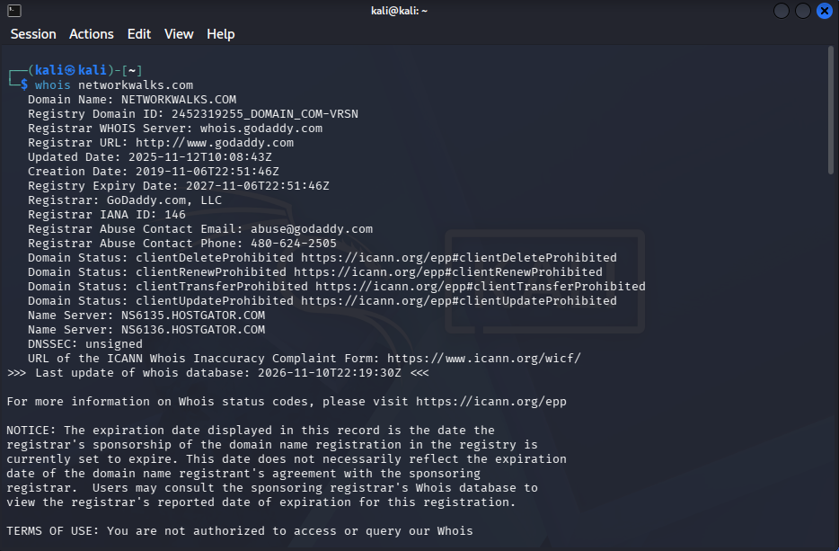
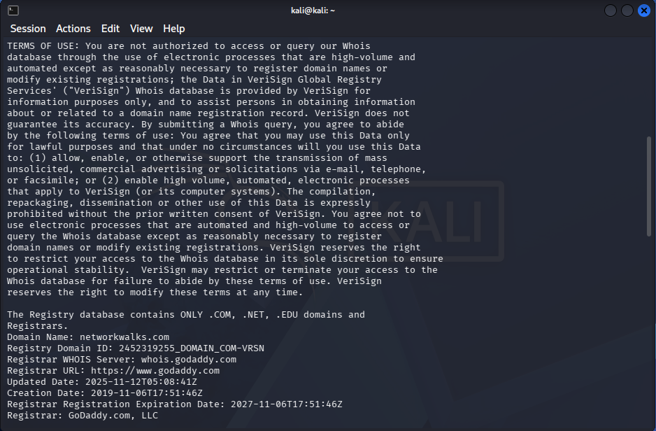
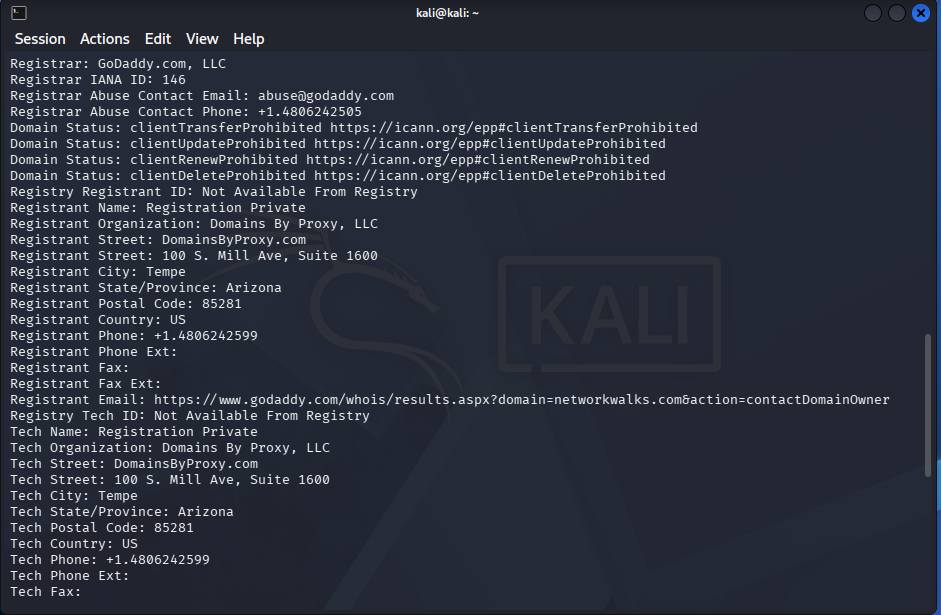
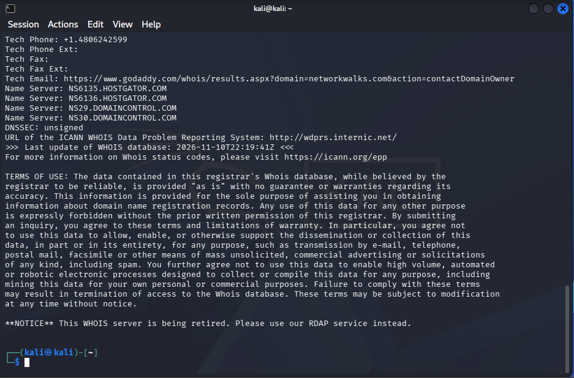
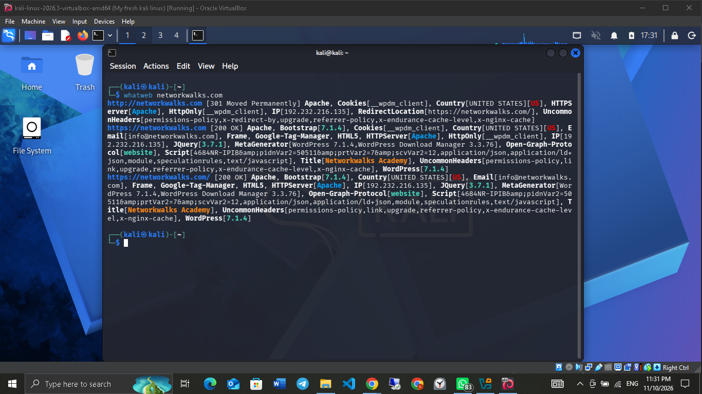
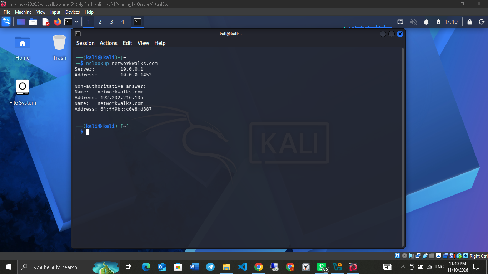
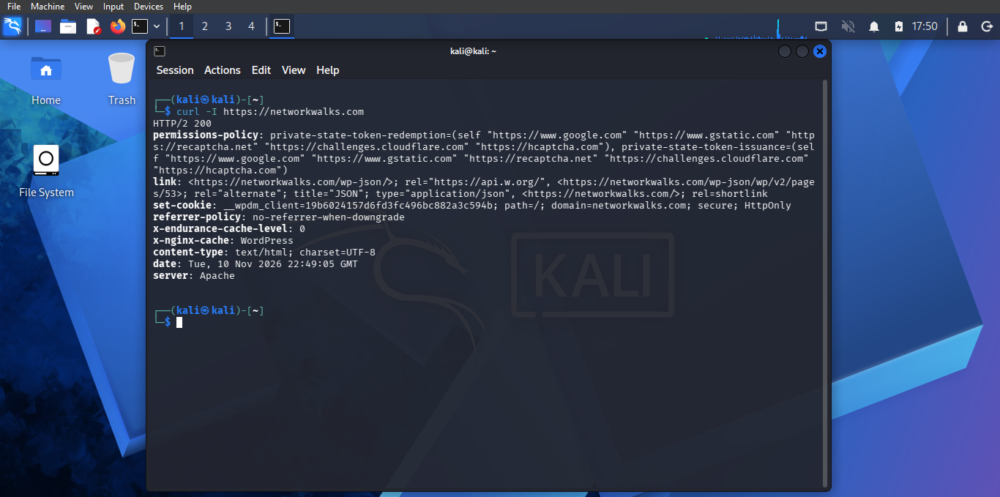
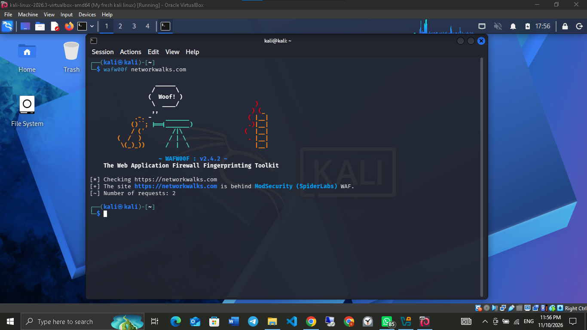
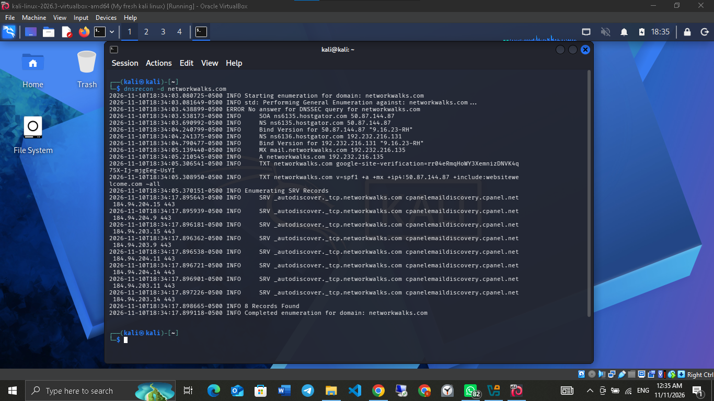
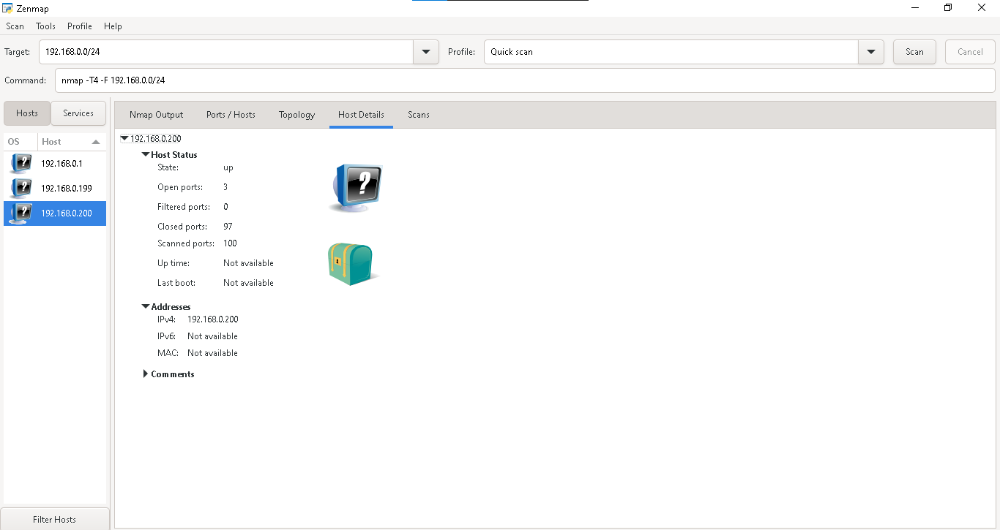

# Week 2: Footprinting & Network Scanning

**Program:** Cybersecurity & Ethical Hacking Internship, Networkwalks
**Author:** Daniel Nwabueze
**Date:** 10 to 11 November 2026
**Modules completed:** W2-PM1 (Footprinting with multiple Kali tools) and W2-PM5 (Network scanning with Zenmap)

> **Disclaimer:** All activities were performed only on systems where I had permission (the Networkwalks training domain, as part of the program) or on devices I own (my own home network). This repository is for education only. Do not use anything here against systems you do not own or have permission to test.

---

## What this project covers

| Phase | Module | Goal |
|-------|--------|------|
| Reconnaissance & Footprinting | W2-PM1 | Collect public information about a target domain using six Kali Linux tools |
| Scanning & Network Discovery | W2-PM5 | Find live hosts on my own local network using Zenmap (Nmap GUI) |

Full written report: [`report/W2-PM-FINAL-Report.pdf`](report/W2-PM-FINAL-Report.pdf?raw=true)

**Lab setup:** Kali Linux running as a virtual machine in Oracle VirtualBox on a Windows PC. Zenmap was run on Windows.

---

## Tools used

| Tool | Purpose |
|------|---------|
| Kali Linux (VirtualBox) | Operating system for reconnaissance |
| WHOIS | Domain registration details (registrar, dates, name servers) |
| WhatWeb | Identify web technologies (server, CMS, plugins) |
| nslookup | Resolve a domain name to an IP address |
| curl -I | Read HTTP response headers |
| wafw00f | Detect a Web Application Firewall (WAF) |
| DNSRecon | Enumerate DNS records (NS, MX, TXT, SPF, SRV) |
| Zenmap | Discover live hosts on a local network |

---

## Module 1: Footprinting (W2-PM1)

**Target:** networkwalks.com (permission granted)

### 1. WHOIS
```bash
whois networkwalks.com
```
- **What it does:** Shows public domain registration data.
- **What I found:**
  - Registrar: GoDaddy.com, LLC
  - Created 2019-11-06, last updated 2025-11-12, expires 2027-11-06
  - Domain locks are on (transfer, update, renew and delete prohibited)
  - Registrant details are hidden behind a privacy service (Domains By Proxy, LLC)
  - Name servers: NS6135.HOSTGATOR.COM, NS6136.HOSTGATOR.COM, NS29.DOMAINCONTROL.COM, NS30.DOMAINCONTROL.COM
  - DNSSEC: unsigned
- **Evidence:**






### 2. WhatWeb
```bash
whatweb networkwalks.com
```
- **What it does:** Fingerprints the website's technologies.
- **What I found:**
  - Web server: Apache
  - CMS: WordPress 7.1.4
  - Plugin: WP Download Manager 3.3.76
  - Other: jQuery 3.7.1, Google Tag Manager, HTML5
  - Server IP: 192.232.216.135 (United States)
  - A contact email address is exposed on the page
  - HTTP redirects to HTTPS (301)
- **Evidence:** 

### 3. nslookup
```bash
nslookup networkwalks.com
```
- **What it does:** Resolves the domain to its IP address using DNS.
- **What I found:** The domain resolves to **192.232.216.135**. An IPv6-format address was also returned, which maps to the same IPv4 address.
- **Evidence:** 

### 4. curl (HTTP headers)
```bash
curl -I https://networkwalks.com
```
- **What it does:** Requests only the HTTP headers of the site.
- **What I found:**
  - HTTP/2 200, server: Apache
  - The `link` header exposes the WordPress REST API paths (`/wp-json/`)
  - A cache-related header shows WordPress caching is in use
  - The cookie is set with `Secure` and `HttpOnly` flags
- **Evidence:** 

### 5. wafw00f
```bash
wafw00f networkwalks.com
```
- **What it does:** Checks whether a Web Application Firewall protects the site.
- **What I found:** The site is behind **ModSecurity (SpiderLabs)** WAF.
- **Evidence:** 

### 6. DNSRecon
```bash
dnsrecon -d networkwalks.com
```
- **What it does:** Lists DNS records for the domain.
- **What I found:**
  - Two name servers (ns6135 and ns6136.hostgator.com)
  - Both name servers reveal their DNS software version (BIND 9.16.23-RH)
  - Mail server: mail.networkwalks.com
  - TXT records include a Google site verification record and an SPF policy (ending in `~all`, a soft fail)
  - Several SRV records for email autodiscovery
  - A DNSSEC query returned no answer
  - 8 records found in total
- **Evidence:** 

---

## Module 2: Network Scanning with Zenmap (W2-PM5)

**Target:** my own home network (subnet `192.168.0.0/24`)

```bash
nmap -T4 -F 192.168.0.0/24    # the command Zenmap ran for the "Quick scan" profile
```

1. Identified my local subnet, then entered it as the target in Zenmap.
2. Ran a **Quick scan** (`-T4 -F`), which scans the 100 most common ports on each host.
3. Found **3 live hosts** on the network.
4. Checked the host details of one device: state **up**, **3 open ports**, 97 closed, 100 scanned.

- **Evidence:** 

> Private IP addresses of my devices are blurred in the screenshot.

---

## Risk summary

| # | Finding | Why it matters | Risk |
|---|---------|----------------|------|
| 1 | WordPress and WP Download Manager versions visible | Attackers can look up known issues for exposed versions | Medium |
| 2 | DNS software version (BIND) exposed by name servers | Helps attackers profile the DNS infrastructure | Medium |
| 3 | Contact email visible on the website | Can be used for phishing or spam | Low |
| 4 | Server IP and DNS records are public | Gives a picture of where the service is hosted | Low |
| 5 | WordPress REST API path advertised in headers | Helps fingerprinting and further enumeration | Low |
| 6 | DNSSEC not enabled | DNS answers are not cryptographically signed | Low |
| 7 | SPF policy uses soft fail (`~all`) | Spoofed emails may be accepted more easily than with a strict policy | Low |
| 8 | WAF type is identifiable (ModSecurity) | Reveals part of the security setup (the WAF itself is a good control) | Low |
| 9 | Multiple live hosts on my home network | Unknown devices on a network should always be checked | Low |

These are observations from information gathering, **not confirmed vulnerabilities**. No exploitation or vulnerability testing was performed.

## Good practices observed

- Domain registration privacy is enabled and domain locks are on.
- The site redirects HTTP to HTTPS.
- Cookies use the `Secure` and `HttpOnly` flags.
- A Web Application Firewall (ModSecurity) is in place.

## Recommendations

- Reduce public version information for the CMS, plugins and DNS software.
- Keep WordPress core and plugins updated.
- Review HTTP headers for unnecessary technical information.
- Consider enabling DNSSEC and review the SPF policy.
- Keep the WAF enabled and tuned.
- Scan your own network regularly and investigate unknown devices.

---

## What I learned

- Even before any attack, a lot can be learned from public information alone: WHOIS, DNS records, HTTP headers and web technologies.
- Each tool answers a different question: who owns the domain (WHOIS), what it runs on (WhatWeb), where it lives (nslookup, DNSRecon), how it responds (curl) and how it is protected (wafw00f).
- Zenmap and Nmap show which devices are alive on a network and which ports are open.
- Findings are observations, not proof of a vulnerability. Confirming one needs further authorized testing.
- Reconnaissance and scanning must always stay within an authorized scope.
- Clear documentation matters: what was done, what was found, why it matters, and how to reduce the risk.

---

## Connect

LinkedIn: [linkedin.com/in/daniel-nwabueze-a63065263](https://www.linkedin.com/in/daniel-nwabueze-a63065263)
